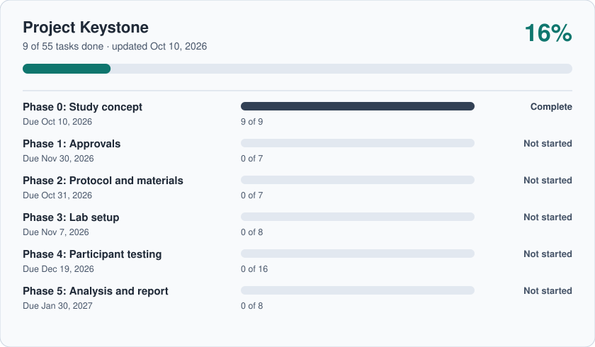

# Project Keystone

A working project tracker built on GitHub, demoed with a fictional research study: a 60-participant clinical validation of a wearable hydration sensor, run by the fictional Lanternfield Labs.

**Tracker website:** https://tezana.github.io/project-keystone/ (live demo: open tasks, mark them done, add notes, create tasks; changes stay in your browser)

## Status

<!-- STATUS:START -->

| Phase | Due | Done | Status |
| --- | --- | --- | --- |
| Phase 0: Study concept | Oct 10, 2026 | 9 / 9 | Complete |
| Phase 1: Approvals | Nov 30, 2026 | 0 / 7 | Not started |
| Phase 2: Protocol and materials | Oct 31, 2026 | 0 / 7 | Not started |
| Phase 3: Lab setup | Nov 7, 2026 | 0 / 8 | Not started |
| Phase 4: Participant testing | Dec 19, 2026 | 0 / 16 | Not started |
| Phase 5: Analysis and report | Jan 30, 2027 | 0 / 8 | Not started |

**Up next (Phase 2: Protocol and materials):**

- [ ] [#17 Confirm inclusion and exclusion criteria](https://github.com/Tezana/project-keystone/issues/17)
- [ ] [#18 Decide the visit schedule: one visit or two](https://github.com/Tezana/project-keystone/issues/18)
- [ ] [#19 Write the informed consent form](https://github.com/Tezana/project-keystone/issues/19)
- [ ] [#20 Build the case report forms](https://github.com/Tezana/project-keystone/issues/20)
- [ ] [#21 Write the sensor calibration procedure](https://github.com/Tezana/project-keystone/issues/21)

**Decisions waiting on you:**

- [#16 Decide whether to add a second study site](https://github.com/Tezana/project-keystone/issues/16)
- [#17 Confirm inclusion and exclusion criteria](https://github.com/Tezana/project-keystone/issues/17)
- [#18 Decide the visit schedule: one visit or two](https://github.com/Tezana/project-keystone/issues/18)
- [#23 Decide: paper or electronic data capture](https://github.com/Tezana/project-keystone/issues/23)
- [#24 Choose the data capture platform](https://github.com/Tezana/project-keystone/issues/24)
- [#25 Choose the statistics software](https://github.com/Tezana/project-keystone/issues/25)
- [#26 Choose the sample storage vendor](https://github.com/Tezana/project-keystone/issues/26)
- [#53 Decide whether to submit to a journal](https://github.com/Tezana/project-keystone/issues/53)

_Updated automatically Oct 10, 2026._
<!-- STATUS:END -->

## How this tracker works

- **Every task is an Issue.** Open the **Issues** tab to see them.
- **Every phase is a Milestone.** Open **Issues > Milestones** to see each phase's progress bar and due date.
- **To finish a task,** open it and click **Close issue**. The dashboard above redraws itself within a minute or two.
- **To add a task,** click **New issue**, then pick its phase under **Milestone** on the right.
- **Labels** sort tasks by type: `admin`, `protocol`, `lab`, `analysis`. Two special ones:
  - `decision`: needs a choice from the study lead. These show up in "Decisions waiting on you."
  - `writeup`: material for the final report or a paper.
- **Every task has an owner.** The study team (name, job title, department) lives in `tracker/team.json`. Each issue stores its owner in a hidden line at the bottom of its description, like `<!-- keystone:owner=mokafor -->`. Assign or reassign people from the website, or on the **Team** page add, edit, and remove team members.

## First-time setup (one time only)

1. Open the **Actions** tab. If GitHub asks, click **I understand my workflows, go ahead and enable them**.
2. Click **Load tasks** on the left, then **Run workflow** > **Run workflow**.
3. Wait about two minutes. The tasks, phases, labels, and the dashboard above will appear.

## What's in this repo

| Path | What it is |
| --- | --- |
| `tracker/tasks.json` | The starting plan: phases, tasks, labels, and who owns each task |
| `tracker/team.json` | The study team: name, job title, and department for each person |
| `scripts/seed.py` | Loads the plan into Issues and Milestones (skips anything already there) |
| `scripts/dashboard.py` | Draws the progress panel from live Issues |
| `.github/workflows/` | The two automations that run those scripts |
| `docs/` | The tracker website (`index.html`) and the data it reads (`data.json`) |
